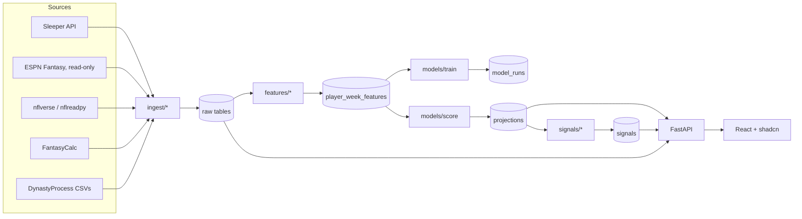
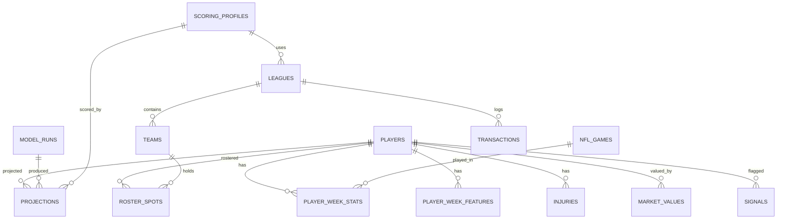

# FantasyEdge — Architecture

## 1. Stack

### Frontend
| Concern | Choice | Why |
|---|---|---|
| Framework | **Vite + React + TypeScript** | Backend is Python, so we don't need Next.js server features; Vite is the simplest SPA setup and shadcn supports it directly. |
| Components | **shadcn/ui** (Radix primitives) | Copy-in components you own and can restyle. |
| Styling | **Tailwind CSS** | Required by shadcn. |
| Icons | **lucide-react** | shadcn's default icon set. |
| Routing | **TanStack Router** (or React Router) | Type-safe routes and search params (filters live in the URL). |
| Server state | **TanStack Query** | Caching, refetch, loading/error states for every API call. |
| Tables | **TanStack Table** | Powers shadcn's Data Table — sorting, filtering, pagination for the Players page. |
| Charts | **Recharts** via shadcn **Chart** components | Matches the shadcn theme out of the box. |
| Forms | **React Hook Form + Zod** | shadcn's Form component is built on these. |
| Client state | **Zustand** (persisted) | Tiny store for "my connected team", scoring profile, UI prefs. |
| API types | **@hey-api/openapi-ts** (or orval) | Generates typed client + TanStack Query hooks from FastAPI's OpenAPI schema — backend and frontend never drift. |
| Search | shadcn **Command** (cmdk) | ⌘K player search anywhere. |
| Toasts | shadcn **Sonner** | "Roster refreshed", errors. |
| Testing | **Vitest + Testing Library**, **Playwright** (e2e) | |
| Lint/format | **Biome** (or ESLint + Prettier) | |
| Package manager | **pnpm** | |

### Backend
| Concern | Choice |
|---|---|
| Language | Python 3.11+ |
| API | **FastAPI** + **Pydantic v2** |
| Data frames | **Polars** (nflreadpy returns Polars natively) |
| Store | **DuckDB** (single file `data/ff.duckdb`) |
| HTTP | **httpx** + **tenacity** (retry/backoff) + on-disk response cache |
| ML | **LightGBM**, **scikit-learn** (splits, metrics), quantile objectives for p10/p90 |
| Scheduling | **GitHub Actions** cron for daily refresh; `POST /refresh` for on-demand |
| Tooling | **uv**, **ruff**, **pytest**, **respx** (mock HTTP with recorded fixtures) |

### Infra
- **Docker Compose**: `api` + `web` services, one command to run locally.
- Later hosting: static frontend on any static host; API on any small container host. DuckDB is fine for single-user; switch to Postgres only if you add multi-user accounts.

---

## 2. Data flow



**Refresh cadence (in season)**
| Job | When | What |
|---|---|---|
| `players_sync` | Daily 6am ET | Sleeper `/players/nfl` → `players` (≤1×/day per Sleeper) |
| `stats_sync` | Tue 6am ET (+ Thu/Mon) | nflverse weekly stats, snaps, injuries, schedules |
| `market_sync` | Daily | FantasyCalc values (fallback DynastyProcess) |
| `score` | After stats_sync | Rebuild features → score → signals |
| `train` | Weekly (Tue) | Retrain + write `model_runs` report |
| `league_sync` | On connect, the **Update** button, and whenever a team is loaded or switched to and its saved copy is over 10 minutes old (`routes/team.py::refresh_if_stale`; falls back to the cached rosters if the platform is unreachable) | Rosters, transactions, records, FAAB |
| `trending_sync` | Every **Update** (and `scope: all`) | Sleeper's most-added / dropped players (24 h), shown on Waivers |

---

## 3. Database schema (DuckDB)



```sql
-- ───────── Reference ─────────
CREATE TABLE players (
  player_id      VARCHAR PRIMARY KEY,   -- internal = nflverse gsis_id when available
  sleeper_id     VARCHAR UNIQUE,
  espn_id        VARCHAR,
  yahoo_id       VARCHAR,
  fantasycalc_id VARCHAR,
  full_name      VARCHAR NOT NULL,
  position       VARCHAR NOT NULL,      -- QB/RB/WR/TE/K/DEF
  nfl_team       VARCHAR,
  birth_date     DATE,
  years_exp      INTEGER,
  status         VARCHAR,               -- Active / IR / FA ...
  depth_chart_order INTEGER,
  injury_status  VARCHAR,               -- Sleeper injury_status: Questionable / Out / IR ...
  updated_at     TIMESTAMP
);

CREATE TABLE nfl_games (
  game_id   VARCHAR PRIMARY KEY,
  season    INTEGER, week INTEGER,
  home_team VARCHAR, away_team VARCHAR,
  kickoff   TIMESTAMP,
  home_score INTEGER, away_score INTEGER
);

-- ───────── Raw stats (from nflverse) ─────────
CREATE TABLE player_week_stats (
  player_id VARCHAR, season INTEGER, week INTEGER,
  game_id VARCHAR, team VARCHAR, opponent VARCHAR,
  snaps INTEGER, snap_pct DOUBLE, routes INTEGER,
  pass_att INTEGER, pass_cmp INTEGER, pass_yds INTEGER, pass_td INTEGER, interceptions INTEGER,
  carries INTEGER, rush_yds INTEGER, rush_td INTEGER,
  targets INTEGER, receptions INTEGER, rec_yds INTEGER, rec_td INTEGER,
  air_yards INTEGER, target_share DOUBLE, air_yards_share DOUBLE, wopr DOUBLE,
  rz_carries INTEGER, rz_targets INTEGER, gl_carries INTEGER,
  rz_td INTEGER,                                   -- rushing+receiving TDs on red-zone plays
  fumbles_lost INTEGER, two_pt INTEGER,
  epa_total DOUBLE,
  PRIMARY KEY (player_id, season, week)
);

CREATE TABLE injuries (
  player_id VARCHAR, season INTEGER, week INTEGER,
  report_status VARCHAR,     -- Out / Doubtful / Questionable
  practice_status VARCHAR,   -- DNP / Limited / Full
  body_part VARCHAR,
  PRIMARY KEY (player_id, season, week)
);

-- ───────── Market (FantasyCalc / DynastyProcess) ─────────
CREATE TABLE market_values (
  player_id VARCHAR, source VARCHAR,           -- 'fantasycalc' | 'dynastyprocess'
  snapshot_date DATE,
  format VARCHAR,                              -- 'redraft_1qb_12_ppr1' etc.
  value DOUBLE, overall_rank INTEGER, position_rank INTEGER,
  trend_30d DOUBLE,
  PRIMARY KEY (player_id, source, snapshot_date, format)
);

CREATE TABLE trending (
  player_id VARCHAR, kind VARCHAR,             -- 'add' | 'drop'
  count INTEGER, lookback_hours INTEGER, fetched_at TIMESTAMP
);

-- ───────── Scoring ─────────
CREATE TABLE scoring_profiles (
  scoring_profile_id VARCHAR PRIMARY KEY,      -- hash of rules JSON
  name VARCHAR,                                -- 'Half PPR default', 'My Sleeper league'
  rules JSON                                   -- {"rec":0.5,"pass_td":4,...}
);

-- ───────── Features / ML ─────────
CREATE TABLE player_week_features (
  player_id VARCHAR, season INTEGER, week INTEGER,   -- features known BEFORE this week
  feature_version VARCHAR,
  features JSON,                                     -- or wide columns once stable
  target_next4_ppg DOUBLE,                           -- NULL for future weeks
  PRIMARY KEY (player_id, season, week, feature_version)
);

CREATE TABLE model_runs (
  run_id VARCHAR PRIMARY KEY,
  trained_at TIMESTAMP,
  model_version VARCHAR, feature_version VARCHAR,
  train_seasons VARCHAR, valid_season INTEGER,
  metrics JSON,                 -- MAE / Spearman by position + baselines
  feature_importance JSON,
  artifact_path VARCHAR,
  is_active BOOLEAN
);

CREATE TABLE projections (
  run_id VARCHAR, player_id VARCHAR, scoring_profile_id VARCHAR,
  season INTEGER, week INTEGER,
  proj_next4_ppg DOUBLE, p10 DOUBLE, p90 DOUBLE,
  proj_ros_points DOUBLE,
  ros_value_par DOUBLE,          -- points above replacement
  PRIMARY KEY (run_id, player_id, scoring_profile_id, season, week)
);

CREATE TABLE signals (
  player_id VARCHAR, scoring_profile_id VARCHAR, season INTEGER, week INTEGER,
  buy_sell_score DOUBLE,         -- -100 (sell) .. +100 (buy)
  market_gap DOUBLE, td_over_expected DOUBLE,
  usage_trend DOUBLE, efficiency_z DOUBLE, playoff_sos DOUBLE,
  reasons JSON,                  -- ["Usage up 3 straight weeks", ...]
  PRIMARY KEY (player_id, scoring_profile_id, season, week)
);

-- ───────── Leagues / "Add your team" ─────────
CREATE TABLE leagues (
  league_id VARCHAR PRIMARY KEY,               -- internal
  platform VARCHAR,                            -- 'sleeper' | 'espn' | 'manual' | 'demo'
  external_id VARCHAR, season INTEGER, name VARCHAR,
  num_teams INTEGER,
  roster_positions JSON,                       -- ["QB","RB","RB","WR","WR","TE","FLEX","BN",...]
  scoring_profile_id VARCHAR,
  trade_deadline_week INTEGER, uses_faab BOOLEAN, faab_budget INTEGER,
  playoff_week_start INTEGER,
  last_synced_at TIMESTAMP
);

CREATE TABLE teams (
  team_id VARCHAR PRIMARY KEY,
  league_id VARCHAR, external_roster_id VARCHAR,
  owner_name VARCHAR, team_name VARCHAR,
  is_mine BOOLEAN,
  wins INTEGER, losses INTEGER, points_for DOUBLE,
  faab_remaining INTEGER
);

CREATE TABLE roster_spots (
  team_id VARCHAR, player_id VARCHAR,
  slot VARCHAR,                                -- 'starter' | 'bench' | 'ir' | 'taxi'
  synced_at TIMESTAMP,
  PRIMARY KEY (team_id, player_id)
);

CREATE TABLE transactions (
  league_id VARCHAR, external_id VARCHAR, kind VARCHAR,  -- trade/waiver/free_agent
  week INTEGER, created_at TIMESTAMP,
  payload JSON,
  PRIMARY KEY (league_id, external_id)
);

CREATE TABLE saved_trades (
  trade_id VARCHAR PRIMARY KEY, league_id VARCHAR, created_at TIMESTAMP,
  give JSON, receive JSON, result JSON
);

-- ───────── Ops ─────────
CREATE TABLE sync_log (
  source VARCHAR PRIMARY KEY,                  -- 'sleeper_players' | 'nflverse' | 'market' | 'league:<id>'
  last_synced_at TIMESTAMP,
  status VARCHAR,                              -- 'ok' | 'stale' | 'error'
  detail VARCHAR
);
```

**Bye weeks** come from `nfl_games`: a team's bye is the regular-season week with no game row. Advisor output, regression flags and bye grids are computed on request from these tables (cheap at single-league scale), not stored.

**Schema additions (Phase 1)** — additive only, no column renamed or removed:
- `players.injury_status`: Sleeper's injury designation, used for availability in projections and bye/lineup math.
- `player_week_stats.rz_td`: TDs scored on red-zone plays, derived from play-by-play. Needed to compute positional red-zone TD rates for *TD over expected*. `routes` stays NULL (no free source).
- `leagues.playoff_week_start`: from Sleeper settings; bounds the fantasy season for bye planning and playoff-schedule strength.
- `sync_log`: last sync time and status per source, served by `/meta/status`.

**Schema additions (Sprints 1–2)**: applied by ordered migrations (`backend/db/migrations.py`).
`schema.sql` is frozen as version 1, and `schema_version` records what a store has applied, so an
existing `ff.duckdb` picks up new columns when it is opened.
- v2 `leagues.league_type`: redraft / keeper / dynasty (from Sleeper `settings.type`); dynasty leagues use dynasty market values.
- v3 `player_week_stats`: `pass_fd`, `rush_fd`, `rec_fd`, `fumbles`, `sacks_taken`, `pass_int_td` (from play-by-play), and `pass_2pt` / `rush_2pt` / `rec_2pt`. Older `two_pt` totals are still scored.
- v4 `player_week_stats`: kicking (`fgm_0_19` … `fgm_60p`, `fgmiss`, `fgm_yds`, `xpm`, `xpmiss`) and team defense (`def_sack`, `def_int`, `def_fum_rec`, `def_ff`, `def_td`, `def_st_td`, `def_safe`, `def_blk_kick`, `def_2pt`, `pts_allow`, `yds_allow`). DEF rows use player_id `sl:<TEAM>`, Sleeper's DEF id.
- v5 `player_week_stats`: `rec_yac`, `pass_yac`, `pass_air_yards` (player-page analytics).
- v6 ESPN leagues: `league_credentials (league_id PK, espn_s2, swid, updated_at)` holds a private
  ESPN league's login cookies in the local file only (the API returns just their last 4
  characters); `leagues.final_week` (ESPN playoff rounds can be 2 weeks long) and
  `leagues.scoring_notes` (league scoring rules that can't be modelled, shown to the user).
  ESPN league ids are `es-<leagueId>-<season>`, teams `es-<leagueId>-<season>-<teamId>`; ESPN
  players map to internal ids via Sleeper's `espn_id`, then the DynastyProcess crosswalk, then name +
  team + position (D/ST → `sl:<TEAM>`), and unmatched players get a name-only `espn:<id>` row.
- v7 injuries and what-ifs: `players.injury_body_part`, `injury_notes`, `injury_start_date` (from
  Sleeper) and `player_availability (player_id PK, out_for_season, return_week, updated_at)`, the
  user's own "out for the season" / "back in week N" per player. `projections.base.resolve_return_week`
  turns these into one `return_week` per player (99 = season over): the user's what-if first, then a
  torn ACL / Achilles (or notes saying "season") on a current IR/PUP/NFI/Out designation. Every
  availability calculation (projections, matchup cells, byes, `RosMath`) reads it.
- The `demo` platform is a fictional league built by `scripts/demo_league.py` in a separate store
  (`data/demo/`), for screenshots and trying the app. It behaves like a synced league but never
  calls out.
- `model_runs` now holds walk-forward backtest results: one row per engine, with metrics by position for all players and the fantasy-relevant subset. The `projections` table is not written yet (Phase 2).

**Key decisions**
- Projections are keyed by **scoring profile** so the same player has different values in PPR vs half-PPR leagues.
- `player_week_features` row for week *W* may only use data from weeks < *W* (enforced by a test).
- `model_runs.is_active` lets you roll back to a previous model without retraining.

---

## 4. API contract (FastAPI)

Live, interactive docs at `http://localhost:8000/docs`.

| Method | Path | Returns |
|---|---|---|
| POST | `/league/connect` `{platform, username}` | A Sleeper user's leagues and teams |
| POST | `/league/espn/connect` `{league_id, season?, espn_s2?, swid?}` | ESPN league + its teams; cookies saved locally, returned masked |
| GET / PUT | `/league/{id}/credentials` | Masked ESPN cookies / replace them (validated against ESPN first). 401 `kind=espn_auth` when they expire |
| GET | `/league/espn/defaults` | League ID and whether cookies are set in `.env` (never the cookies) |
| POST | `/league/{id}/select-team` `{external_roster_id}` | Marks `is_mine`, syncs |
| POST | `/league/manual` | Creates a manual league/team (lineup, bench/IR depth, scoring, starters/IR roles) |
| GET | `/teams/saved` | Every team you've picked (Sleeper, ESPN, manual, demo), for the team switcher |
| GET | `/team/{id}` | Roster with values, this week's best lineup, grades by position vs the league |
| PATCH / DELETE | `/team/{id}` | Rename a manual team / delete a manual team or forget a Sleeper/ESPN league (rosters, transactions, saved trades and ESPN login, in one transaction) |
| PUT | `/team/{id}/roster` | Edit a manual team |
| GET | `/team/{id}/advice` | Ranked advisor feed + team grade |
| GET | `/team/{id}/startsit?week=` | Real vs best lineup for a week (matchup-adjusted; finished games locked), slot eligibility |
| GET | `/team/{id}/waivers` | Free agents by net ROS lineup gain after the best drop, FAAB range, Sleeper trending adds |
| GET | `/team/{id}/players?q=&pos=&team=&avail=&sort=&dir=&page=&size=` | Players table, filtered, sorted and paged on the server |
| GET | `/team/{id}/players/{pid}` | Player page: bio, verdict, availability (injury detail, return week, your what-if), game log, projected vs actual, analytics |
| GET | `/team/{id}/players/{pid}/trades?want=` | Trades built around one player |
| GET | `/team/{id}/rankings?top=` | Top N per position by schedule-adjusted points, each week and ROS |
| GET | `/team/{id}/buy-targets` | Undervalued players to buy, your overvalued ones |
| GET | `/team/{id}/regression` | Regression flags with `size` (vs threshold) and per-player `strength`, strongest first |
| GET | `/team/{id}/byes` | Week-by-week bye grid, unfillable slots, danger weeks |
| PUT / DELETE | `/players/{pid}/availability` `{out_for_season?, return_week?}` | Your availability what-if for a player / back to the injury report |
| GET | `/players?q=&pos=&limit=` | Player search (pickers) |
| POST | `/trade/evaluate` `{team_id, give[], receive[]}` | Both sides' lineup change ROS, verdict (hypothetical when `receive` isn't on a league roster) |
| GET | `/trade/suggest?team_id=&page=` | Mutually beneficial ideas after forced drops; each page is new deals |
| POST | `/trade/find` `{team_id, give[1-3], want_position, receive_count}` | Deals across the league for the players you name |
| GET / PUT / DELETE | `/settings` | Tunable weights and thresholds (only changed values are stored) |
| POST | `/refresh` `{scope: league\|market\|all}` | Sync jobs |
| GET | `/meta/status` | Last-sync times per source, NFL week |

Planned, not built: a `/model/report` transparency page and a standalone buy/sell board.

All responses are Pydantic models → OpenAPI → generated TS client.

---

## 5. Frontend structure

```
frontend/src/
├── api/                    # generated client + query hooks (do not edit; python tasks.py gen-api)
├── components/
│   ├── ui/                 # shadcn components (+ data-table.tsx on TanStack Table v9)
│   ├── common/             # states (error/empty/skeleton), BackToTop
│   ├── layout/             # AppLayout, AppSidebar, TeamSwitcher
│   ├── connect/            # ESPN connect form, league/team picker
│   ├── player/             # badges, matchups, analytics, PlayerTrades, AvailabilityControl
│   └── team/               # RosterTable, grades, RegressionList, ManualRosterBuilder
├── routes/                 # advisor, team, team-edit, startsit, byes, players, player, rankings,
│                           # buy-targets, trade, waivers, connect, settings
├── hooks/useHistory.ts     # in-memory undo/redo (Start/Sit planner)
├── lib/                    # lineup + startsit rules, regression filters, faab, formatters
└── stores/team.ts          # Zustand (persisted): the active team (saved teams come from the API)
frontend/e2e/               # Playwright specs, API mocked from e2e/fixtures (CI: Chromium)
frontend/screenshots/       # README screenshots from the demo league (python tasks.py screenshots)
```

**Tests:** vitest + Testing Library for components and pure logic; Playwright (`python tasks.py e2e`,
Chromium + Firefox locally, Chromium in CI) for drag-and-drop and the phone sidebar.

**shadcn components to install:** sidebar, card, table (data-table), tabs, badge, button, input, select, command, dialog, sheet, tooltip, chart, skeleton, sonner, form, avatar, separator, progress, toggle-group.

**Design tokens:** one fixed color per position (QB, RB, WR, TE) used everywhere; buy = green, sell = red, hold = neutral; dark mode default.
