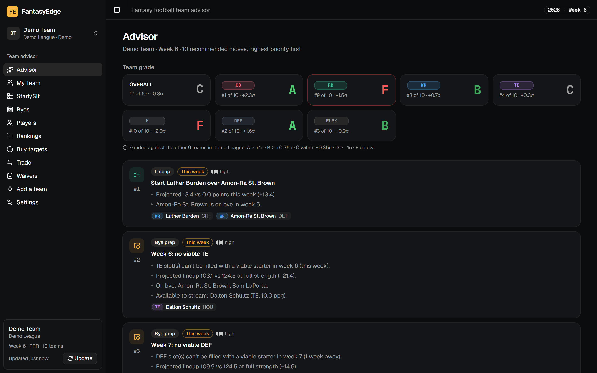
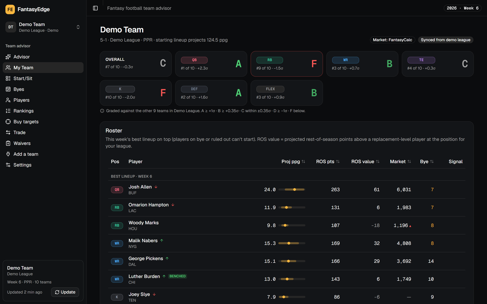
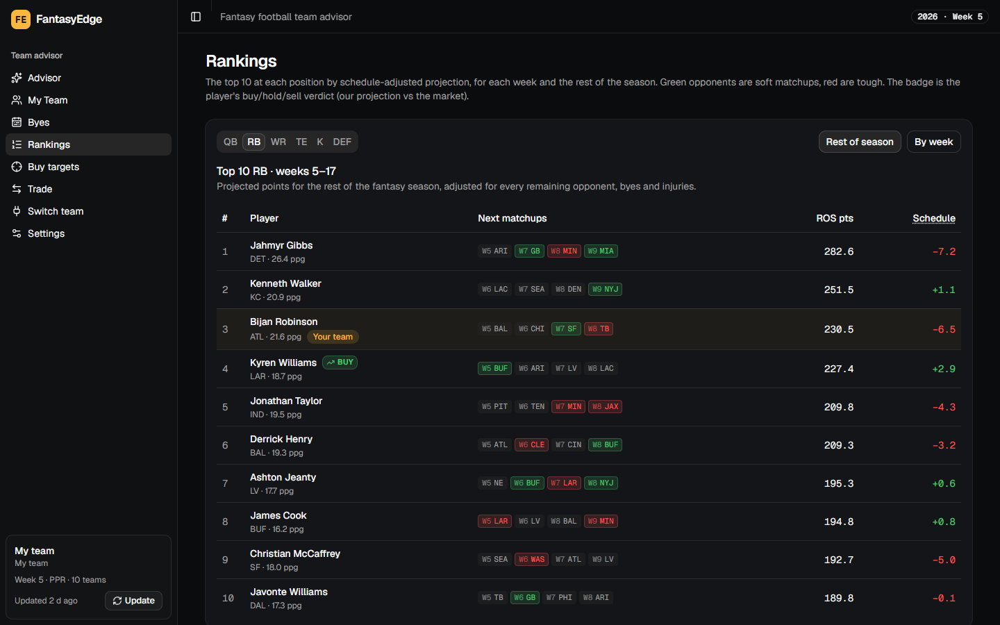
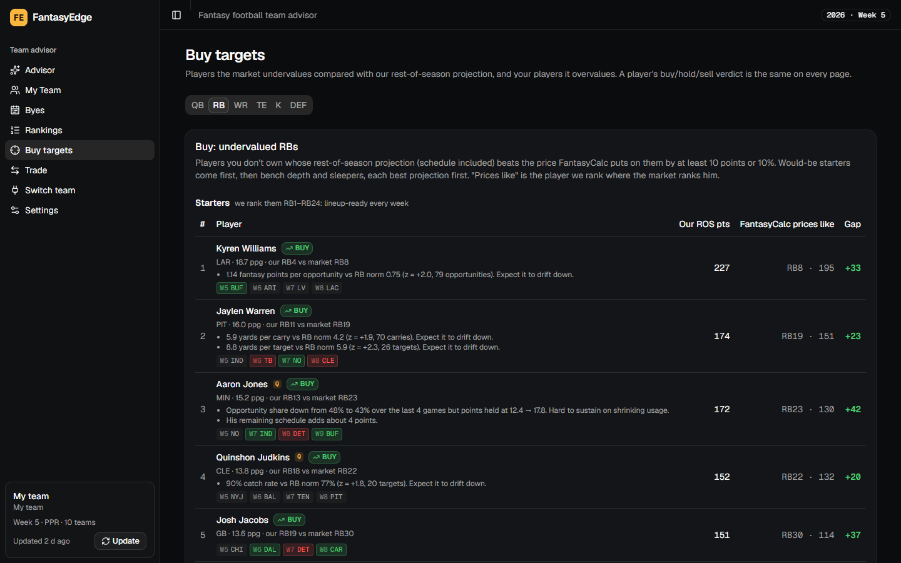
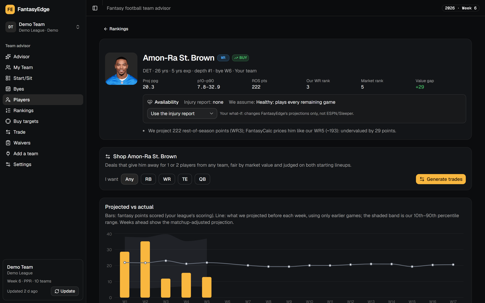
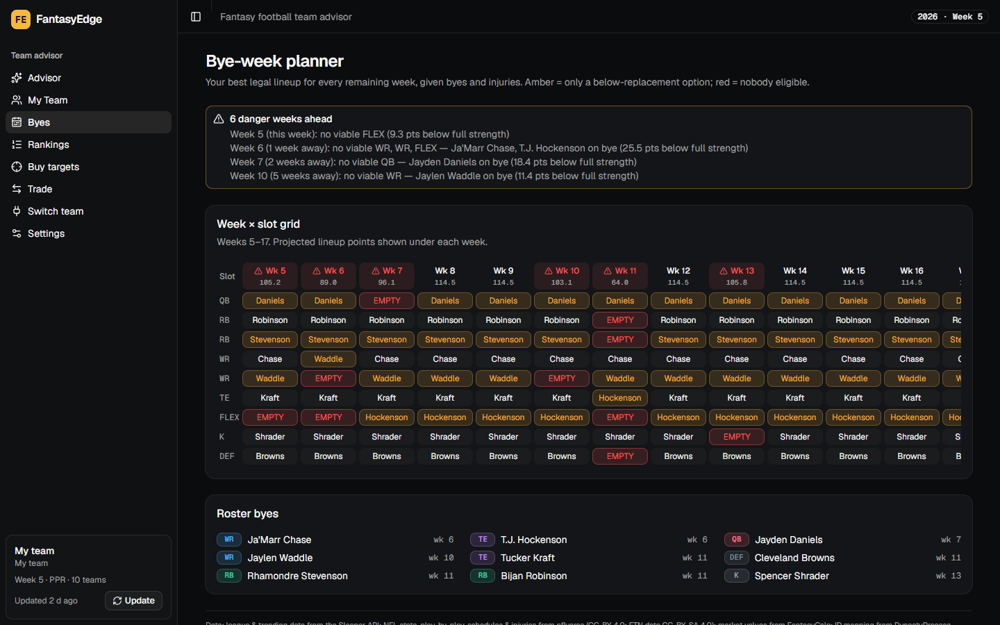
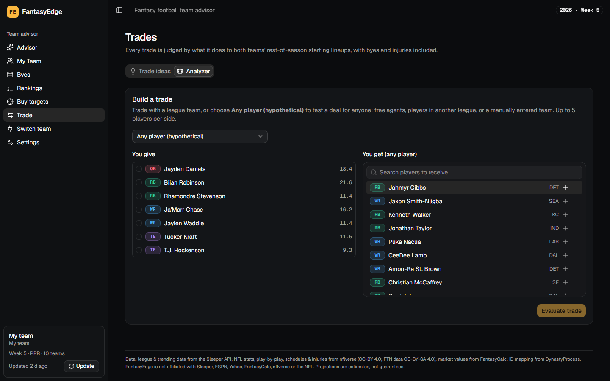
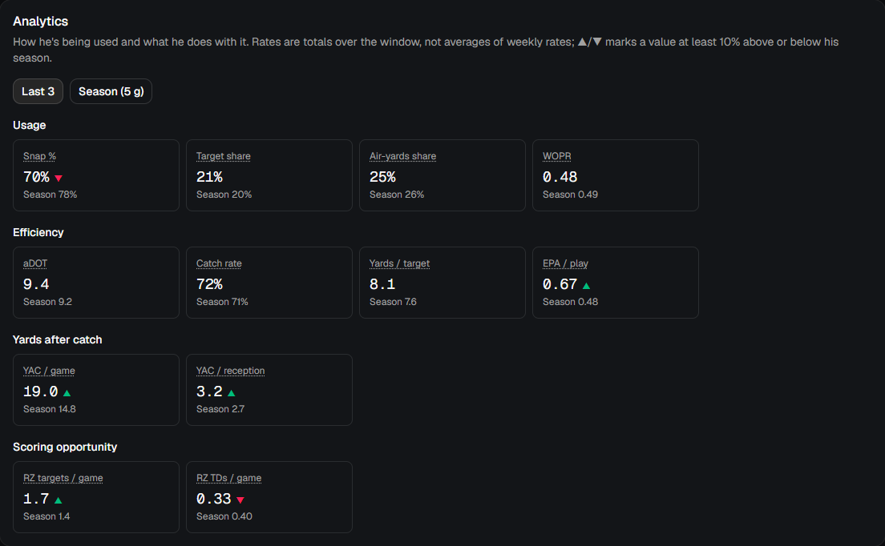
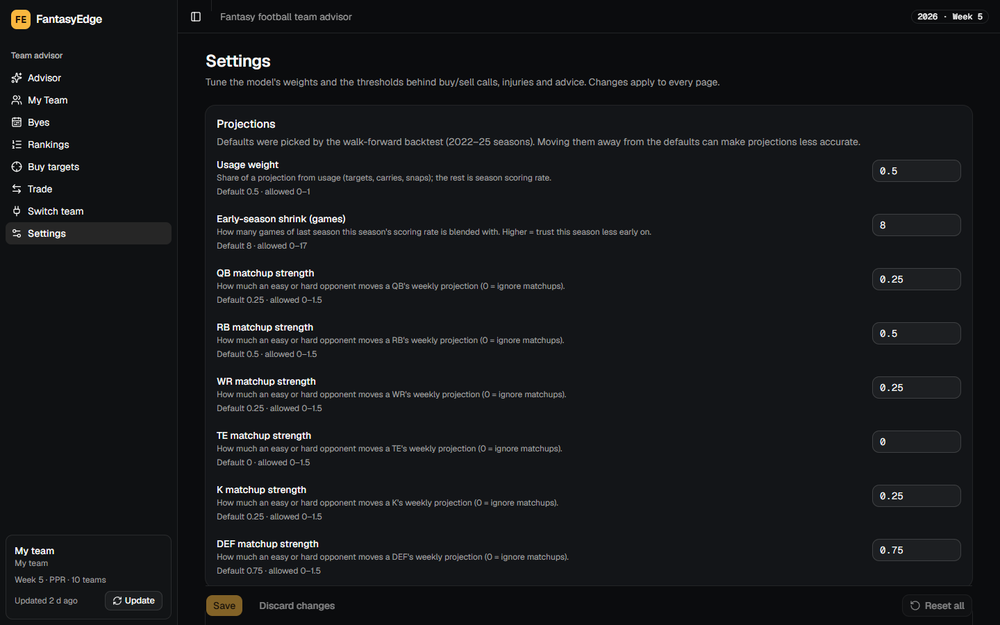

# FantasyEdge

[](https://github.com/ShaneV2001/FantasyEdge/actions/workflows/ci.yml)
[](LICENSE)

**An open-source fantasy football assistant that tells you what to do with your team, and shows its work.**



Connect your **Sleeper** or **ESPN** league (private ESPN leagues included), or enter a roster by
hand, and FantasyEdge gives you:

| Page | What you get |
|---|---|
| **Advisor** | A ranked list of 5–10 concrete moves (trade, sell, buy, waiver, lineup, bye prep), each with the numbers behind it, an urgency and a confidence level. |
| **My Team** | Your roster with projections, rest-of-season value and a buy/hold/sell verdict for every player, this week's best lineup (players on bye or ruled out are tagged and left out), plus team grades for QB, RB, WR, TE, K, DEF and each flex slot against the rest of your league. |
| **Rankings** | The top 10 at every position for each upcoming week and for the rest of the season, adjusted for schedule. |
| **Buy targets** | Players the market undervalues that you don't own (would-be starters first, then bench depth and sleepers), and your own players it overvalues. |
| **Player pages** | Headshot and bio, the verdict and why, projected vs actual points for every week, upcoming matchups, a game log, and an **Analytics** card: snap %, target and rush share, air yards, WOPR, aDOT, efficiency, yards after catch and red-zone work over the last 3 games, last 5 or the season. |
| **Byes** | A week-by-week grid of which lineup slots you can and can't fill, with "danger weeks" flagged before they arrive. |
| **Trade** | **Trade ideas** where *both* starting lineups improve (ask for a fresh set any time), **Find a trade** ("these two players for a running back": every team searched), and an **Analyzer** for any deal. Each deal shows who would have to be dropped to make room and how every remaining week changes, bye weeks included. |
| **Settings** | Tune the projection weights, buy/sell thresholds, injury assumptions and advisor rules, with the backtest-tuned defaults one click away. |

Under the hood:
- **Your league's scoring:** every stat line is re-scored under your league's own scoring settings (Sleeper or ESPN), including kickers and team defense.
- **Measured accuracy:** a walk-forward backtest over 2023–2025 picked the projection weights and the schedule adjustment, and every number is published below.
- **Regression flags:** who is scoring on unsustainable touchdowns or efficiency, and how well those flags have actually predicted declines.

Everything runs on your computer with free data. There are no accounts, API keys or paid services.
Data only flows **in**: FantasyEdge never changes anything on Sleeper or ESPN.

### Screenshots

| | |
|---|---|
|  |  |
| **My Team**: grades by position, roster values, position strength | **Rankings**: schedule-adjusted top 10, by week or rest of season |
|  |  |
| **Buy targets**: what we project vs what the market charges | **Player page**: projected vs actual, every week |
|  |  |
| **Byes**: which slots you can fill each week | **Trade**: judged on both teams' starting lineups |



**Player analytics**: last 3 / last 5 / season, with ▲/▼ against the season value



**Settings**: every weight and threshold, with the backtest-tuned defaults

> **Project status:** the team advisor, rankings, buy/sell verdicts, player pages with analytics,
> trades and settings all work end to end on live Sleeper or ESPN + nflverse + FantasyCalc data,
> with CI on every push. Projections are transparent formulas tuned by backtest; a machine-learning model replaces
> them only if it beats them on a held-out season (see [Roadmap](#roadmap)).

---

## Contents

- [Screenshots](#screenshots)
- [Connecting your league](#connecting-your-league)
- [How it works](#how-it-works)
- [Quick start](#quick-start)
- [Project layout](#project-layout)
- [API](#api)
- [Data sources & attribution](#data-sources--attribution)
- [Roadmap](#roadmap)
- [Contributing](#contributing)
- [Disclaimer](#disclaimer) · [License](#license)

---

## Connecting your league

Open the **Connect** page and pick a tab.

**Sleeper:** enter your Sleeper username, choose the league, and pick your team. Nothing else is
needed: Sleeper's API is public.

**ESPN:** enter your **League ID** (the number after `leagueId=` in your league's web address) and
the season. A **public** league needs nothing more. A **private** league also needs two login
cookies from your browser:
1. On a computer, log in at fantasy.espn.com and open your league.
2. Open the browser's developer tools (F12).
3. **Chrome / Edge:** *Application* tab → *Cookies* → `https://fantasy.espn.com`.
   **Firefox:** *Storage* tab → *Cookies* → `https://fantasy.espn.com`.
4. Copy the values of `espn_s2` and `SWID` (keep SWID's curly braces) into the form.

Your team is recognised from your SWID. You can also put the three values in your local `.env` file
(`ESPN_LEAGUE_ID`, `ESPN_S2`, `ESPN_SWID`) and leave the cookie fields empty.

- **Where the cookies go:** they're stored only in the database on your computer and are only ever
  sent to ESPN. They're never logged, and the app only shows their last 4 characters.
- **When they expire** (every few months), you'll see "Your ESPN login has expired — paste fresh
  cookies". Copy new ones the same way and use **Replace cookies** on the ESPN tab.
- **Your league's settings** come across as-is: lineup slots, scoring, trade deadline, playoff weeks
  and FAAB. Any rostered player we can't match to our player data is listed, not silently dropped.
- ESPN doesn't publish an official API. FantasyEdge reads the same data the ESPN website loads
  (`lm-api-reads.fantasy.espn.com`), read-only, with your own login.

**Manual entry:** build a roster for any platform (league size, lineup, scoring, bench and IR) and
edit it later from My Team.

The sidebar's **Update** button re-pulls your Sleeper or ESPN rosters at any time.

---

## How it works

Every number in FantasyEdge comes from a formula you can read and change. The constants live at the
top of each module, nothing is hidden inside a model, and the ones you'd most want to tweak are on
the [Settings](#settings) page.

### League-aware scoring
Your league's scoring settings are read directly and every historical stat line is re-scored under
them, so the same player has a different value in a PPR league than in a standard one. A setting your
league doesn't list is worth 0, as it is on Sleeper and ESPN. Supported: passing, rushing and receiving yards,
TDs and receptions; TE/RB/WR reception bonuses; interceptions and pick-sixes; sacks taken; fumbles
and fumbles lost; first downs; 2-point conversions; the 100/200/300/400-yard and 25-completion
bonuses; kicking by distance, FG yards, misses and PATs; and team defense (sacks, takeaways, TDs,
safeties, blocked kicks, points- and yards-allowed brackets). Other keys are ignored and logged.
Manual leagues can pick Standard, Half-PPR or PPR (with Sleeper's standard K/DEF scoring).

**ESPN leagues:** ESPN's scoring rules (including per-position values, such as a tight-end reception
bonus) are converted to the same rules. ESPN's yardage bonuses don't stack (a 250-yard game earns
only the 200+ bonus), and its D/ST points-allowed ranges differ from Sleeper's (14–17, 18–21, 22–27,
35–45, 46+); both are handled exactly. Checked against a real league: every rostered player's
weekly stat line scores the same as ESPN's own total. The few rules that can't be modelled from
public stats (for example a 1-point safety) are listed on the Connect page as scored 0.

### Projections
```
projected PPG = 0.5 × season PPG + 0.5 × usage-implied PPG
```
- **Usage-implied PPG** = recent targets, carries and pass attempts × the positional league-average
  points per opportunity, plus expected touchdowns from where the opportunities happened (red zone
  vs. elsewhere).
- Early in the season (< 8 games), season PPG is blended with last season's.
- **Kickers and defenses** have no usage model. Their weekly scoring is mostly noise, so each one's
  average is pulled strongly toward the positional average (as if it had 128 extra average games).
- The weights were chosen by the backtest below. The original blend also used last-3-game PPG
  (0.5 last 3 / 0.3 season / 0.2 usage), but recent form made projections worse.
- **Rest-of-season points** = projected PPG × the games left, skipping the bye, games already played
  this week, and expected missed time (Out this week; IR/PUP assumed out 4 more weeks).
- **ROS value** = points above replacement at the player's position, for your league size and
  lineup slots (FLEX and SUPER_FLEX are counted as a position mix).
- A 10th–90th percentile band comes from each player's week-to-week volatility.

### Accuracy (walk-forward backtest)
`python tasks.py backtest` replays the 2023–2025 seasons: for every week, each engine projects using
only earlier games, then is scored against what happened. Fantasy-relevant players are the top
QB24 / RB60 / WR60 / TE24 / K16 / DEF16 projected each week; MAE is against each player's average
over the next 4 games, half-PPR.

| Position | FantasyEdge baseline | Season PPG | Last 3 games |
|---|---|---|---|
| QB | **4.28** | 4.62 | 5.29 |
| RB | **3.85** | 4.06 | 4.54 |
| WR | **3.73** | 4.20 | 4.58 |
| TE | **3.08** | 3.27 | 3.82 |
| K | **2.26** | 3.23 | 3.48 |
| DEF | **2.46** | 3.14 | 3.49 |
| All | **3.50** | 3.91 | 4.37 |

The weights were tuned on 2023–24 and checked on 2025 (4-week MAE 4.08 → 3.76 on that held-out
season). The 10th–90th percentile band holds 79% of next-game scores (target 80%). Kicker and
defense projections only match a flat positional average: their week-to-week scoring barely
predicts itself, so real per-team edges need matchup data. Results are stored in `model_runs`.

### Regression flags
| Signal | Rule | Example message |
|---|---|---|
| TD over expected | Expected TDs = red-zone opportunities × positional red-zone TD rate + other opportunities × non-red-zone rate. A gap of **≥ +2** means "due to cool off"; **≤ −2** means "due to bounce back". | "5 TDs on 11 red-zone touches (72 total opportunities); expected ~2.2. Likely to slow down." |
| Efficiency outliers | Yards per carry (≥ 30 carries), yards per target and catch rate (≥ 20 targets), and fantasy points per opportunity, as z-scores against positional norms. **\|z\| ≥ 1.5** is flagged. | "6.2 yards per carry vs RB norm 4.2 (z = +2.2, 87 carries). Expect it to drift down." |
| Usage vs production | Share of team opportunities over the last 4 games vs points scored. Rising usage with falling points means production should catch up; falling usage with steady points is a warning sign. | "Opportunity share up from 15% to 30% over the last 4 games while points went 9.0 → 4.0." |

**How well they work** (`python -m models.run regression-eval`, weeks 6–14 of 2023–2025): each
flagged player's next-4-week PPG change is compared with unflagged players at the same position and
a similar PPG, so ordinary regression to the mean isn't credited to the flag. **Sell-high flags
work:** flagged players fell a further 1.1 (efficiency), 1.4 (TD over expected) and 1.6 (usage)
points per game, beating similar players 61–67% of the time. **Buy-low flags are no better than a
coin flip** (46–50%, about 0 PPG of lift), so treat them as context rather than a reason to trade.

### Rankings (schedule)
The **Rankings** page ranks the top 10 at every position, across all players, for each upcoming week
and for the rest of the season. Each week's projection is the player's per-game projection × expected
availability × a matchup multiplier, `1 + α × (opponent index − 1)`:
- **Opponent index:** fantasy points the opponent allows to that position vs league average, with
  this season shrunk toward last season. For a defense, the opponent is the offense it faces.
- **α per position:** how far a matchup moves the projection, chosen by the walk-forward backtest
  (`python -m models.run tune-matchups`). It was tuned on 2023–24 and kept only where 2025 improved.

| | QB | RB | WR | TE | K | DEF |
|---|---|---|---|---|---|---|
| α | 0.25 | 0.5 | 0.25 | 0 | 0.25 | 0.75 |
| 2025 next-week MAE, no adjustment → adjusted | 6.49 → 6.46 | 4.09 → 4.08 | 3.72 → 3.72 | 3.08 (no gain) | 3.79 → 3.77 | 4.30 → 4.18 |

Schedule matters most for defenses: matchups double the week-to-week ranking accuracy of DEF
projections (weekly Spearman 0.12 → 0.23). Elsewhere the effect is small, and for tight ends
matchups didn't help, so the TE ranking ignores schedule. Each row also shows what the schedule adds
or costs versus an average set of opponents.

### One verdict per player: buy, hold or sell
Every player gets a single verdict, shown the same way on My Team, Rankings, Buy targets, the player
page and in the advisor. It compares **our projection with the market's price**:
- **Our points:** his schedule-adjusted rest-of-season points (the Rankings numbers).
- **The market's price:** if FantasyCalc ranks him RBr, he's priced like the player *we* rank RBr,
  so his market-implied points are that player's projection.
- **Buy** when we project at least max(10 points, 10%) more than his price; **sell** when at least
  that much less; otherwise **hold**. Only players in the startable pool get a call (we must rank a
  buy inside QB24 / RB60 / WR60 / TE24; the market must rank a sell there). Without a market value
  (most kickers and defenses) the verdict is hold.

Regression flags don't decide the verdict. In the backtest, adding them to the projection made
accuracy worse, because the projection already carries their signal: it is half usage-based, so a
back running hot on efficiency already projects below his pace. The flags are listed as reasons
instead.

The **Buy targets** page lists, per position, the undervalued players you don't own, and your
own players the market overvalues. Buys come in two tiers: **Starters** (we rank him above the
league's starter line, e.g. WR1–WR24 in a 10-team, 2-WR + flex league) first, then **Bench depth &
sleepers**. Each tier is ordered by our rest-of-season points, so a cheap deep sleeper with a big
gap never outranks a would-be starter.

### Player pages
Click any player for a headshot, bio, verdict and reasons, upcoming matchups, a game log, and a chart
of what we projected before each week (using only earlier games) against what he scored.

The **Analytics** card shows how a player is used and what he does with it, over his last 3 games,
last 5, or the season:
- **Usage:** snap %, rush share, target share, air-yards share, WOPR.
- **Efficiency:** aDOT, catch rate, completion %, yards per target / carry / attempt, EPA per play.
- **Yards after catch:** YAC per game and per reception (YAC share of passing yards for QBs).
- **Scoring opportunity:** red-zone carries and targets, goal-line carries, red-zone TDs.

Rates are totals over the window (catch rate = catches ÷ targets in those games), counts are per
game, and ▲/▼ marks a window at least 10% above or below the season value. Shares are against the
team's QB/RB/WR/TE totals in the same games. A window that would cover the whole season is skipped.

### Bye-week planner
Bye weeks come straight from the NFL schedule: a team's bye is the week it has no game. For every
remaining week, FantasyEdge builds your best legal lineup from the players available that week and marks
each slot **ok**, **thin** (only a below-replacement option) or **empty**. A **danger week** is
one where a slot is worse than it is at full strength, so a position that's weak all season doesn't
flag every week.

**This week's best lineup** (top of My Team, and the Advisor's start/sit advice) only uses players
who play this week: anyone on bye or ruled out is tagged **BYE** / **OUT** and left on the bench. When
a bye leaves a slot short, the Advisor suggests a free agent for **each** short slot (for example a
WR *and* a D/ST), not just the highest scorer.

### Trades
Each trade is scored by its effect on **both teams' rest-of-season starting-lineup points**,
recomputed week by week with byes and injuries included. Model value and FantasyCalc market value are
shown alongside.

- **Roster spots:** if a trade leaves a team over its roster limit (starting + bench spots), it has
  to drop someone. FantasyEdge drops whoever costs that lineup the fewest points (never a player just
  acquired), shows it as **Must drop**, and counts it in the result. Injured players sit on IR while
  the team has an open IR spot.
- **Bye weeks:** every remaining week is checked for both teams. Each card shows the week-by-week
  change, and weeks a deal would leave a lineup slot unfilled are marked in red.
- **Trade ideas** are 1-for-1 and 2-for-1 deals where both lineups gain after any drops, neither team
  is left short in a week it can fill today, and the market values are close enough that the other
  manager might accept. **Show different ideas** pages through new deals without repeats;
  **Refresh** re-syncs your league first.
- **Find a trade:** pick 1–3 of your players and the position you want back (or any), 1 or 2
  players. Every team is searched for deals that improve your lineup. Deals the other lineup also
  likes come first; the rest are marked **Unlikely to accept**. Any idea opens in the **Analyzer**
  to adjust.
- Trade ideas are hidden once your league's trade deadline passes (the analyzer still works for
  what-ifs).

### The advisor feed
Candidate actions are ranked by:
```
priority = urgency weight × impact × confidence weight
```
- **Urgency weights:** this week 3.0 · before byes 2.2 · before deadline 1.6 · rest of season 1.0
- **Sell** and **Buy** actions come straight from the player's verdict (above): your players with a
  sell verdict, and other teams' players with a buy verdict at your weakest positions. Confidence and
  impact grow with the size of the value gap.
- Team grades cover QB, RB, WR, TE, K, DEF and each flex slot; "needs" only ever include QB–TE.

### Settings
The **Settings** page (sidebar; it works before you connect a league) lets you change 24 values in
four groups. Every page recomputes as soon as you save.

| Group | What you can change | Defaults |
|---|---|---|
| Projections | Usage vs season-rate weight, early-season shrink (games), matchup strength (α) per position | 0.5 · 8 · QB .25 / RB .5 / WR .25 / TE 0 / K .25 / DEF .75 |
| Buy/sell & targets | Gap needed for a call (points and share of price), startable depth per position, players per Buy-targets tier | 10 pts or 10% · QB24 / RB60 / WR60 / TE24 · 10 |
| Injuries | Chance a Questionable / Doubtful player plays this week, weeks assumed out on IR/PUP/NFI | 85% · 25% · 4 |
| Advisor & trades | Minimum gain for waiver and start/sit advice, easy/tough schedule cutoffs, trade accept / lean-accept lines | 1.5 ppg · 1.0 pts · 1.08 / 0.92 · 8 / 2 pts |

- The projection defaults were picked by the backtest, and the page marks them so. Moving them can
  make projections less accurate. The backtest itself always runs on the defaults.
- Each field shows its default and allowed range, with a reset link. **Reset all** goes back to
  every default.
- Settings are saved in `data/settings.json`, which holds **only the values you changed**. You can
  share the file or edit it by hand. If it can't be read, the app uses the defaults and the
  Settings page shows a warning, and the next save replaces the file.

---

## Quick start

**Requirements:** Python 3.11+, [uv](https://docs.astral.sh/uv/), Node 20+ (pnpm comes via `corepack`).

```bash
git clone https://github.com/ShaneV2001/FantasyEdge.git && cd FantasyEdge
cp .env.example .env

python tasks.py setup   # install backend (uv) and frontend (pnpm) dependencies
python tasks.py data    # pull Sleeper players, nflverse stats/schedules/injuries, market values
python tasks.py dev     # API on http://localhost:8000, web app on http://localhost:5173
```

| Command | What it does |
|---|---|
| `python tasks.py data` | Refresh all data (≈15 MB Sleeper player map at most once/day, nflverse files, market values) |
| `python tasks.py test` | `ruff` lint/format check, `pytest` (offline, recorded fixtures), `oxlint` and `vitest` for the frontend |
| `python tasks.py api` / `web` | Run the API or the web app on its own |
| `python tasks.py gen-api` | Regenerate the typed TypeScript client from the API's OpenAPI schema |
| `python tasks.py backtest` | Walk-forward accuracy of every projection engine (downloads 4 seasons once, cached in `data/backtest/`) |
| `cd backend && uv run python -m models.run regression-eval` / `tune` / `tune-matchups` | Check the regression flags; search projection weights, flag thresholds and matchup strength against a held-out season |

If you have `make`, the same targets work as `make setup`, `make data`, `make dev`, `make test`.

All data lives in `data/` (gitignored): a single DuckDB file, an HTTP response cache, and your
`settings.json` if you've changed any settings.

> DuckDB allows one writing process at a time, so stop the API before running `python tasks.py data`
> (or use the **Update** button / `POST /refresh` while it's running).

**Using it:** open http://localhost:5173, connect your Sleeper or ESPN league (see
[Connecting your league](#connecting-your-league)), pick your team, and the Advisor page opens. The
**Update** button in the sidebar re-pulls rosters and transactions.

---

## Project layout

```
backend/
  app/          FastAPI app, Pydantic schemas, services (league sync, cached league context),
                user_settings.py (the Settings values and data/settings.json)
  ingest/       sleeper.py, espn.py, nflverse.py, market_values.py, idmap.py, http.py (retry + cache)
  db/           DuckDB schema (v1 baseline) + ordered migrations
  scoring/      league scoring rules → fantasy points; espn.py converts ESPN scoring settings
  projections/  engine interface, phase-1 baseline, naive comparison engines, positional norms
  models/       walk-forward backtest, regression-flag evaluation, tuning CLI
  signals/      regression, byes, lineup optimizer, team grades, trades, advisor
  tests/        unit + API tests on recorded fixtures (no live network calls)
frontend/       Vite + React + TypeScript + shadcn/ui, TanStack Router/Query, Zustand, Recharts
  src/api/      generated typed client + TanStack Query hooks (python tasks.py gen-api)
  src/routes/   connect, advisor, team, byes, rankings, buy-targets, player, trade, settings pages
  src/components/player/  analytics card, matchups, badges
  src/components/connect/ ESPN connect form, league/team picker
scripts/        fixture recorders (the ESPN one anonymises a real league before saving it)
.github/        CI: backend lint + tests, frontend lint + typecheck + tests, API-client drift check
```

[ARCHITECTURE.md](ARCHITECTURE.md) is the source of truth for the stack, database schema, API
contract and frontend structure.

---

## API

FastAPI serves interactive docs at `http://localhost:8000/docs`. Endpoints:

| Method | Path | Purpose |
|---|---|---|
| POST | `/league/connect` | Sleeper username → your leagues and teams |
| POST | `/league/espn/connect` | ESPN league ID + season (+ cookies for a private league) → the league and its teams |
| GET / PUT | `/league/{id}/credentials` | Saved ESPN cookies, masked (last 4 characters) / replace them (checked with ESPN first) |
| GET | `/league/espn/defaults` | League ID and whether cookies are set in your local `.env` (never the cookies) |
| POST | `/league/{id}/select-team` | Mark which team is yours |
| POST | `/league/manual` | Create a league from a hand-entered roster |
| GET | `/team/{id}` | Roster with projections, values, grades by position |
| GET | `/team/{id}/advice` | Ranked advisor feed + team grade |
| GET | `/team/{id}/regression` | Regression flags for your roster and the league |
| GET | `/team/{id}/byes` | Week × slot bye grid and danger weeks |
| GET | `/team/{id}/rankings` | Top 10 per position by schedule-adjusted points, each week and rest of season |
| GET | `/team/{id}/buy-targets` | Undervalued players to buy and your overvalued players, per position |
| GET | `/team/{id}/players/{player_id}` | Player page: bio, verdict, game log, projected vs actual by week, L3/L5/season analytics |
| POST | `/trade/evaluate` | Score a proposed trade for both sides |
| GET | `/trade/suggest?page=` | Mutually beneficial trade ideas; each page is new deals |
| POST | `/trade/find` | Deals for players you name, for a position you want (1 or 2 players back) |
| POST | `/refresh` | Re-sync league, market or all data |
| GET | `/settings` | Every setting: value, default, range, help text (and a warning if `settings.json` was unreadable) |
| PUT | `/settings` | Change some settings, e.g. `{"gap_min_points": 15}`; out-of-range values get a 422 |
| DELETE | `/settings` | Reset all settings to the defaults |
| GET | `/meta/status` | Last sync time per source, current NFL week |

---

## Data sources & attribution

| Source | Used for | Terms |
|---|---|---|
| [Sleeper API](https://docs.sleeper.com) | Leagues, rosters, players, trending adds/drops | Free for non-commercial use. FantasyEdge stays far below the rate limit and fetches the player map at most once per day. Trending data is credited to Sleeper wherever it's shown. |
| ESPN Fantasy (fantasy.espn.com) | Your ESPN league: settings, scoring, rosters, records, transactions | Read-only, with your own login cookies for a private league. No official public API; FantasyEdge reads the same data the ESPN site loads and never writes to it. |
| [nflverse](https://github.com/nflverse) via [`nflreadpy`](https://github.com/nflverse/nflreadpy) | Weekly stats, play-by-play (red-zone splits), snap counts, schedules, injuries | Data licensed **CC-BY 4.0**; FTN charting data **CC-BY-SA 4.0**. |
| [FantasyCalc](https://fantasycalc.com) | Crowd-sourced trade market values | Unofficial endpoint, cached for 24 h; the app falls back gracefully if it changes. |
| [DynastyProcess data](https://github.com/dynastyprocess/data) | Player ID crosswalk (Sleeper ↔ nflverse ↔ ESPN/Yahoo), fallback market values | Open data repository. |

FantasyEdge does not scrape web pages. It uses public APIs, published data files and, for ESPN,
the JSON data the ESPN site itself loads for your league.

---

## Roadmap

| Phase | Scope | Status |
|---|---|---|
| 1 | **Team Advisor MVP**: ingestion, rule-based projections, regression report, bye planner, trade analyzer and finder, advisor feed; Connect, Advisor, My Team, Byes and Trade pages | ✅ done |
| 1.5 | **Measured and tuned**: walk-forward backtest, tuned baseline, K/DEF projections, schedule adjustment, one verdict per player, Rankings, Buy targets, player pages with analytics, team grades for every slot, Settings, CI | ✅ done |
| 1.75 | **ESPN and smarter trades**: ESPN leagues (private too), this week's best lineup and bye advice, trades that account for roster spots and both teams' byes, more trade ideas on demand, the trade finder | ✅ done |
| 1.9 | **Rest of this round**: Players table, saved teams with a team switcher, page-scroll fix after the player menus, a shorter regression report, Waivers page, Start/Sit lineup planner | in progress |
| 2 | **Better projections** (each change ships only if the 2025 holdout improves) | next |
| 3 | **Waivers** | planned |
| 4 | **More leagues and easier running** | planned |

**Phase 2: better projections**
- Use opportunity quality in the projection: snap share, WOPR, air yards and goal-line carries are
  already collected and shown on player pages, but the projection doesn't use them yet.
- Read practice participation (the injury report) and stop games a player left early from dragging
  his average down.
- Skewed 10th–90th percentile bands: fantasy scoring has a long upside tail, and the band is
  symmetric today.
- A prior for rookies and players with no history, from their market value, so they don't project
  0 until they play.
- A LightGBM model with quantile bands, swapped in only if it beats the tuned baseline.

**In progress (this round)**
- **Players** page: every player, searchable, filtered by position, team and who owns him, sortable by
  projection, value, market value and verdict; filters kept in the URL.
- **Saved teams**: manual teams, Sleeper and ESPN connections kept between sessions, with a team
  switcher in the sidebar.
- **Page scroll fix** after using the player menus, with a browser test.
- **Shorter regression report**: the 20 strongest flags first, filters, "show more".
- **Waivers** page: best free agents for *your* lineup, the suggested drop, a FAAB bid range, and
  Sleeper trending adds.
- **Start/Sit** planner: this week's best lineup, drag-and-drop what-ifs with undo/redo, and a copyable
  lineup (changes never touch Sleeper or ESPN).

**Phase 3: waivers**
- FAAB bid ranges, informed by Sleeper's trending adds and drops.
- Waiver pickups that would upgrade your bench, not just your starters.

**Phase 4: more leagues and easier running**
- Yahoo league connector.
- Background data refresh with a progress indicator, incremental play-by-play downloads, and a
  data-freshness panel.
- Docker Compose.

---

## Contributing

Issues and pull requests are welcome. Please:
- run `python tasks.py test` before opening a PR. Tests must pass offline, against fixtures. CI runs
  the same checks, plus a typecheck and a check that the generated API client is up to date
  (`python tasks.py gen-api`).
- for a model change, include the `python tasks.py backtest` numbers; it ships only if the held-out
  season improves.
- keep feature and signal functions small, typed and pure, and include unit tests.
- never commit secrets. Use `.env` (see `.env.example`).
- respect each data source's terms and rate limits, and route HTTP through `ingest/http.py`.

---

## Disclaimer

FantasyEdge is an independent project and is **not affiliated with, endorsed by, or sponsored by**
Sleeper, ESPN, Yahoo, FantasyCalc, DynastyProcess, nflverse or the NFL. All trademarks belong to their
respective owners. Projections are estimates, not guarantees. Use them to inform your decisions, not
to make them for you.

## License

[MIT](LICENSE)
