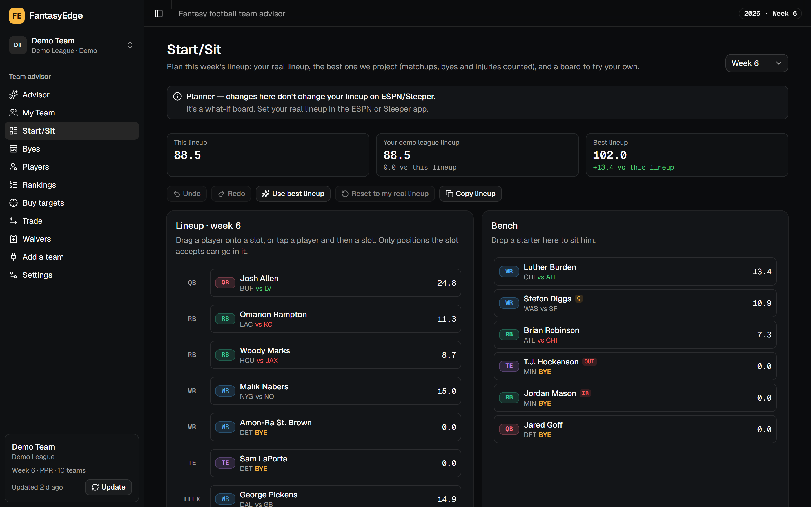
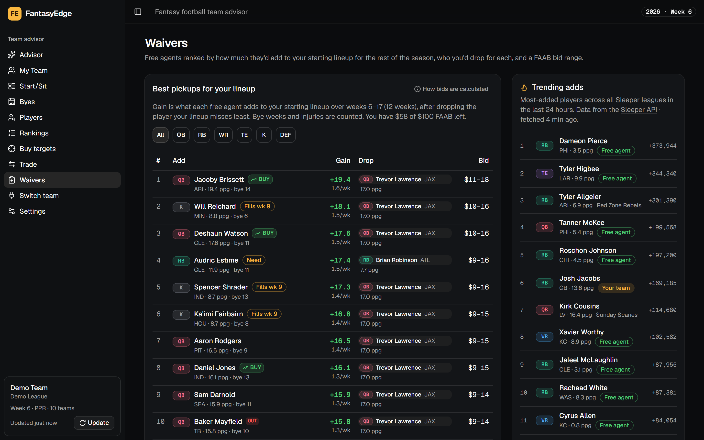
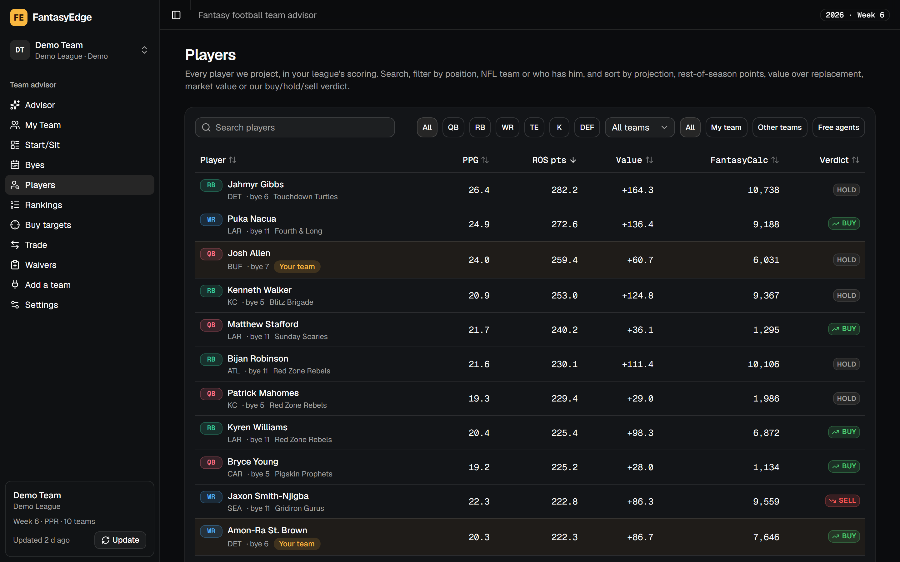
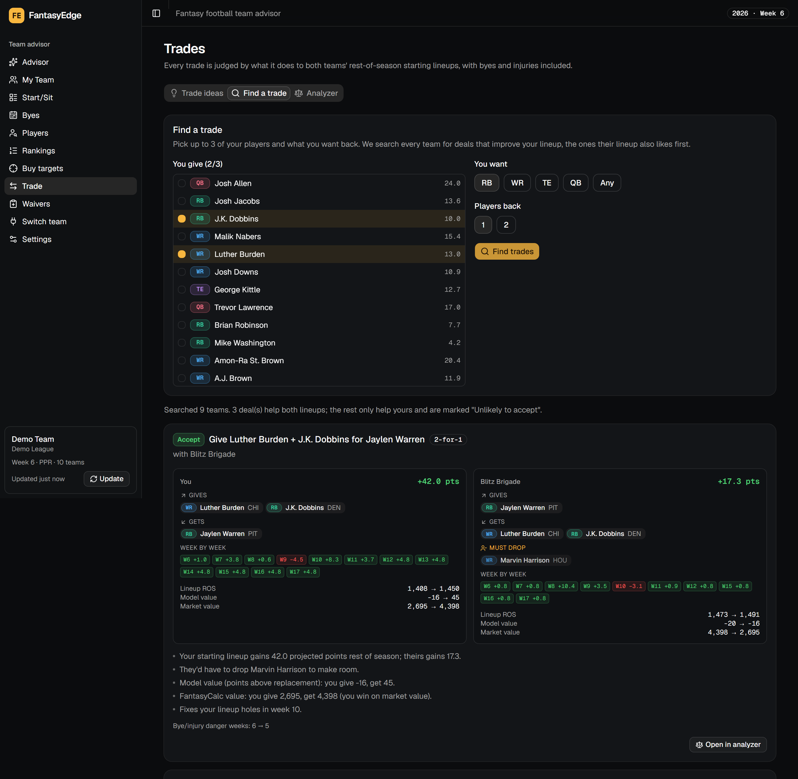
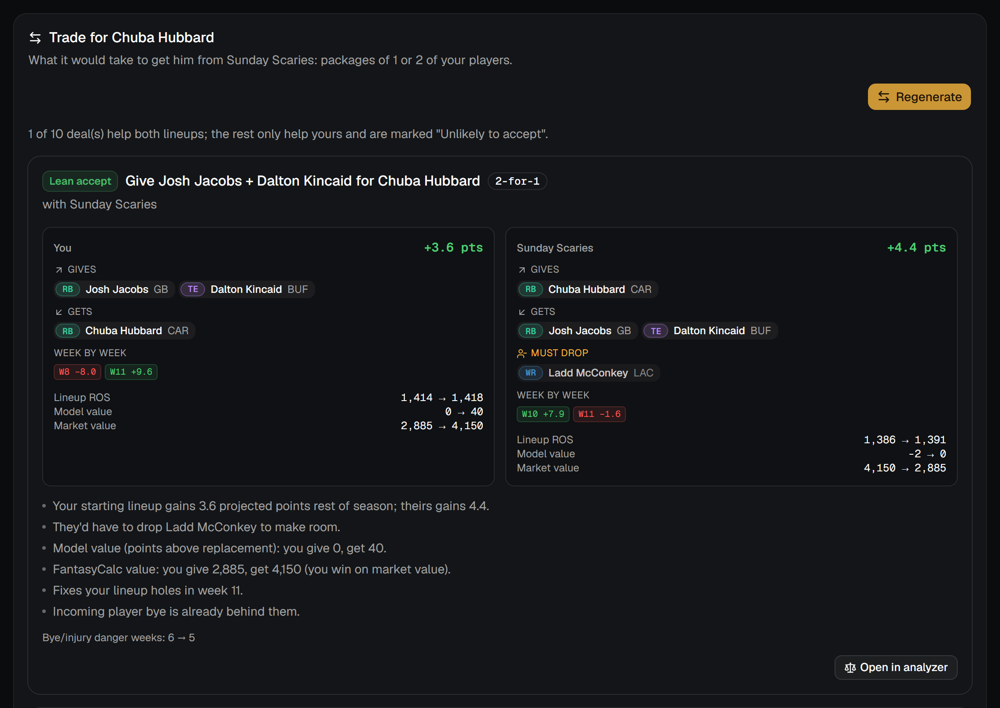
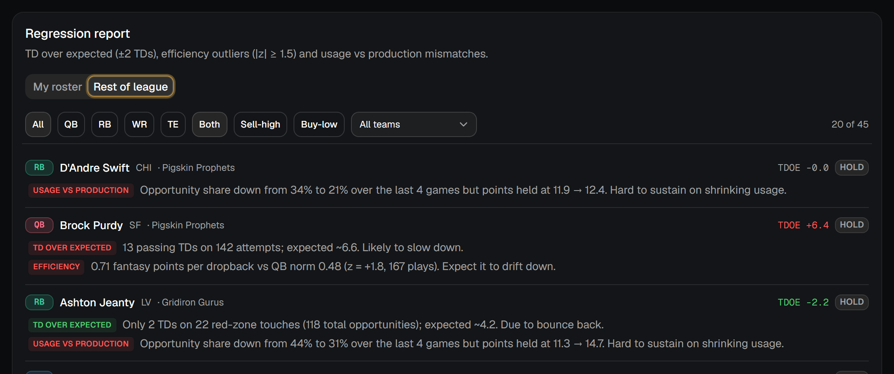
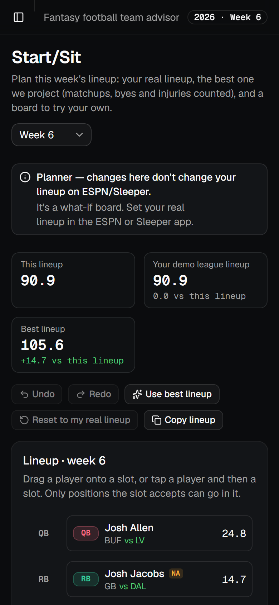

# FantasyEdge

[](https://github.com/ShaneV2001/FantasyEdge/actions/workflows/ci.yml)
[](LICENSE)

**A free, open-source fantasy football assistant that tells you what to do with your team, and shows its work.**


Connect your **Sleeper** or **ESPN** league (private ESPN leagues too), or enter a roster by hand.
Everything runs on your own computer with free data: no accounts, no API keys, no paid services.
Data only flows **in**. FantasyEdge never changes anything on Sleeper or ESPN.

## What you get

| Page | What it does |
|---|---|
| **Advisor** | 5–10 concrete moves (lineup, waiver, trade, buy, sell, bye prep), ranked, each with the numbers behind it. |
| **My Team** | Your roster with projections and a buy/hold/sell verdict per player, this week's best lineup, grades for every position vs your league, and a regression report: who is due to cool off or bounce back, strongest signals first. |
| **Start/Sit** | This week's best lineup vs the one you've set, plus a drag-and-drop board to try your own, with undo, reset and copy. Only valid moves are allowed. |
| **Waivers** | Free agents ranked by how much they'd add to *your* lineup for the rest of the season, who you'd drop and why, a FAAB bid range, and Sleeper's trending adds. |
| **Players** | Every player: search, filter by position, team or who owns him, and sort by projection, rest-of-season points, value or verdict. |
| **Trade** | Ideas where *both* lineups improve, "find me a running back for these two players", and an analyzer for any deal. Bye weeks are counted for both teams, and when a team has to make room it cuts who a manager would: an extra K or D/ST, surplus depth, or its lowest-value bench player. |
| **Rankings / Buy targets** | Schedule-adjusted top 10–30 at every position, and players the market undervalues. |
| **Player pages** | Projected vs actual points every week, usage and efficiency, trades built around him, and an injury what-if ("out for the season", "back in week 12"). |
| **Byes** | A week-by-week grid of the lineup slots you can't fill, flagged before those weeks arrive. |

Switch between saved teams from the sidebar. Every weight and threshold can be tuned in **Settings**.

| | |
|---|---|
|  |  |
| **Start/Sit**: best lineup, real lineup, and a planner | **Waivers**: net gain after the drop, FAAB range |
|  |  |
| **Players**: every player, sortable and filterable | **Find a trade**: judged on both teams' lineups |

<p align="center"></p>

<details>
<summary><b>More screenshots</b>: My Team, regression report, player page, byes, rankings, buy targets, phone</summary>

| | |
|---|---|
|  |  |
| **My Team**: grades, this week's best lineup, roster values | **Regression report**: strongest signals first, with filters |
|  |  |
| **Player page**: availability what-if, trades, projected vs actual | **Byes**: the lineup slots you can't fill, week by week |
|  |  |
| **Rankings**: schedule-adjusted, by week or rest of season | **Buy targets**: what we project vs what the market charges |

<p align="center"></p>

</details>

*Screenshots use a fictional demo league (`python tasks.py demo`).*

## How it works

Every number comes from a formula you can read and change; nothing is hidden inside a model.

- **Your league's scoring.** Every past stat line is re-scored under your league's own settings
  (Sleeper or ESPN), kickers and defenses included.
- **Projections.** `projected PPG = 0.5 × season PPG + 0.5 × usage-implied PPG`. Usage-implied points
  come from targets, carries and red-zone opportunities. Each week is then adjusted for the
  opponent, byes and injuries.
- **Injuries.** Questionable and doubtful players count a fraction of this week. IR means out for a
  few weeks. A torn ACL or Achilles in the injury report means out for the season. You can override
  any player.
- **One verdict per player.** *Buy* when we project at least 10 points (or 10%) more than the market
  (FantasyCalc) prices him, *sell* when that much less, otherwise *hold*.
- **Everything is judged on your starting lineup.** Trades and pickups are scored by what they do
  to each team's rest-of-season starting lineup, week by week, after any player you'd have to drop.
- **Who gets dropped.** When a trade or pickup overfills a roster, FantasyEdge cuts who a manager
  would: an extra kicker or D/ST first, then surplus depth (a 4th QB), then the bench player with
  the lowest market value (our own projection when the market has no price for him), never a
  starter while bench depth remains. Each drop says why.

**Measured, not guessed.** A walk-forward backtest replays 2023–2025, projecting each week from
earlier games only. The weights were tuned on 2023–24 and checked on 2025.

| Avg error, next 4 games (pts/game) | QB | RB | WR | TE | K | DEF | All |
|---|---|---|---|---|---|---|---|
| **FantasyEdge** | **4.28** | **3.85** | **3.73** | **3.08** | **2.26** | **2.46** | **3.50** |
| Season average | 4.62 | 4.06 | 4.20 | 3.27 | 3.23 | 3.14 | 3.91 |
| Last 3 games | 5.29 | 4.54 | 4.58 | 3.82 | 3.48 | 3.49 | 4.37 |

**Regression flags, honestly:** *sell-high* flags (touchdowns or efficiency above what usage
supports) did predict declines, of 1.1–1.6 points per game. *Buy-low* flags were a coin flip, so
they're shown as context, not as a reason to trade.

## Connect your league

- **Sleeper:** enter your username, choose the league and your team.
- **ESPN:** enter the League ID (the number after `leagueId=` in your league's address). A
  **private** league also needs the `espn_s2` and `SWID` cookies from a logged-in browser
  (developer tools → Application/Storage → Cookies → `fantasy.espn.com`). They're stored only on
  your computer, sent only to ESPN, and never logged.
- **Manual:** build a roster for any platform.

Rosters refresh automatically when they're more than 10 minutes old, or anytime with **Update**.

## Run it

Requires Python 3.11+, [uv](https://docs.astral.sh/uv/) and Node 20+.

```bash
git clone https://github.com/ShaneV2001/FantasyEdge.git && cd FantasyEdge
cp .env.example .env
python tasks.py setup   # install dependencies
python tasks.py data    # download players, stats, schedules and market values
python tasks.py dev     # open http://localhost:5173
```

| Command | What it does |
|---|---|
| `python tasks.py test` | Lint, backend and frontend tests (offline, on recorded data) |
| `python tasks.py e2e` | Browser tests in Chromium and Firefox |
| `python tasks.py demo` | Run the app on a fictional demo league (stop `dev` first) |
| `python tasks.py backtest` | Re-run the accuracy backtest |

[ARCHITECTURE.md](ARCHITECTURE.md) covers the stack, database and API. The live API docs are at
http://localhost:8000/docs.

## Data & attribution

| Source | Used for |
|---|---|
| [Sleeper API](https://docs.sleeper.com) | Leagues, rosters, players, injuries, trending adds (non-commercial use) |
| ESPN Fantasy | Your ESPN league, read-only, with your own login |
| [nflverse](https://github.com/nflverse) | Stats, play-by-play, schedules (CC-BY 4.0; FTN data CC-BY-SA 4.0) |
| [FantasyCalc](https://fantasycalc.com) | Trade market values |
| [DynastyProcess](https://github.com/dynastyprocess/data) | Player ID crosswalk |

FantasyEdge is not affiliated with Sleeper, ESPN, Yahoo, FantasyCalc, DynastyProcess, nflverse or the
NFL. Projections are estimates, not guarantees. Contributions are welcome: run `python tasks.py test`
first, and model changes ship only if the backtest improves. [MIT licensed](LICENSE).
